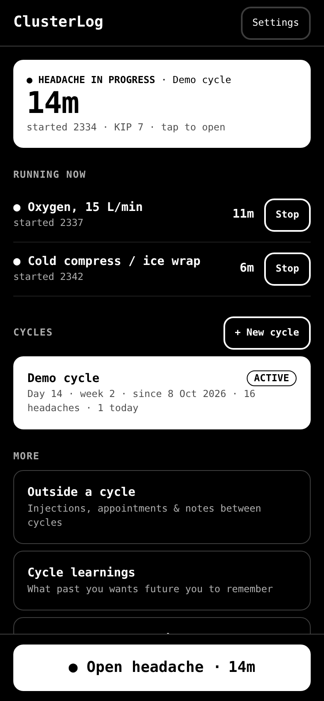
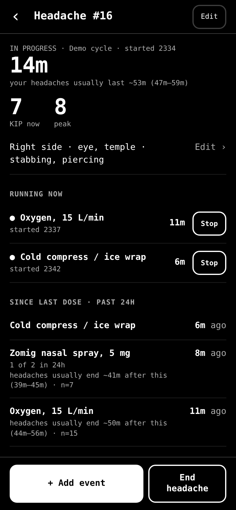
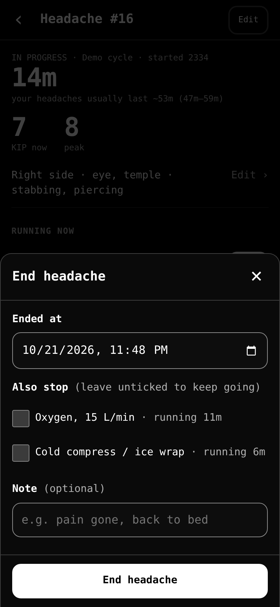
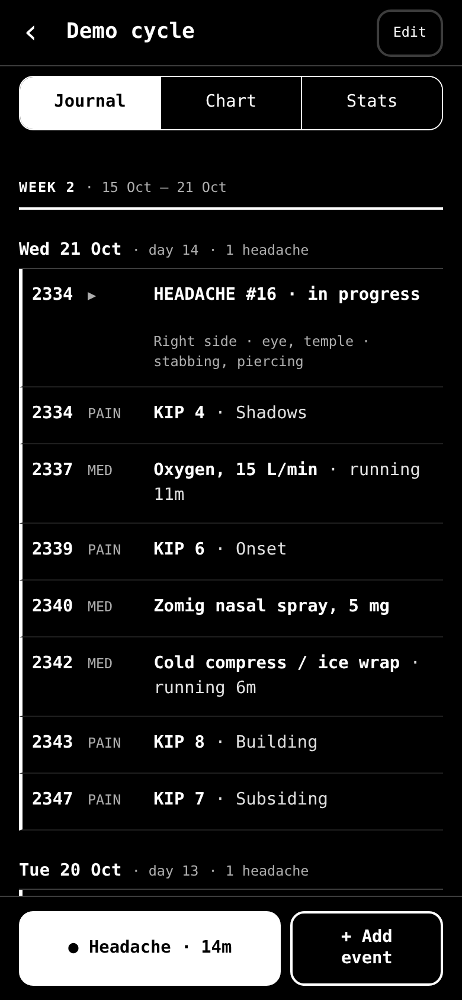
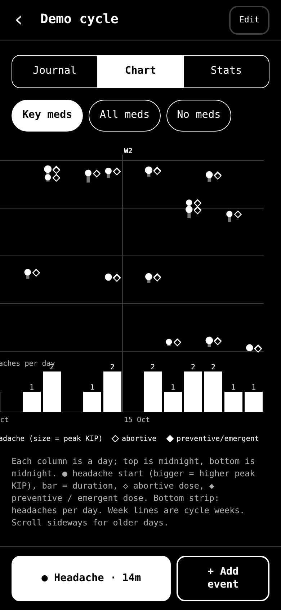
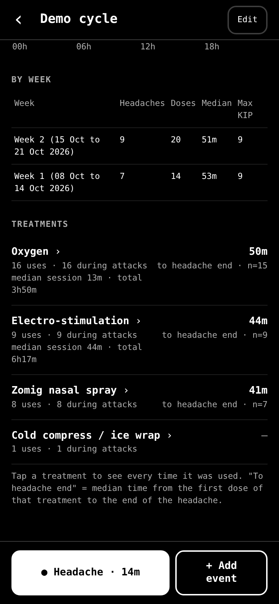
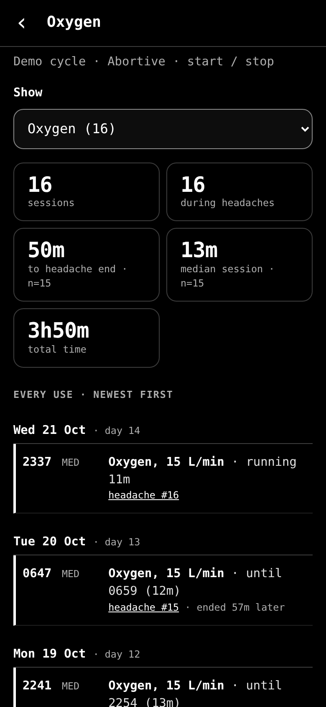

# ClusterLog

A self-hosted, phone-first journal for cluster headaches. Log a headache one tap
at a time while it's happening, fill in or correct the details later, and
download a plain-text date-range report to email to your neurologist.

Black background, white monospace text, big tap targets. Runs in Docker on a
homelab box; all data is one SQLite file you own.

## Screenshots

<sub>Made-up demo data, iPhone-sized screen.</sub>

<table>
<tr>
<td width="33%"><br><sub><b>Home</b> — headache in progress, treatments running</sub></td>
<td width="33%"><br><sub><b>During a headache</b> — KIP, running treatments, time since each dose</sub></td>
<td width="33%"><br><sub><b>End headache</b> — optionally stop oxygen / ice too</sub></td>
</tr>
<tr>
<td><br><sub><b>Journal</b> — by cycle week and day</sub></td>
<td><br><sub><b>Chart</b> — when headaches and doses happen</sub></td>
<td><br><sub><b>Stats</b> — per week and per treatment</sub></td>
</tr>
<tr>
<td><br><sub><b>One treatment</b> — every use, session lengths</sub></td>
<td colspan="2" valign="top">

**Report excerpt** (plain text, for the neurologist):

```text
Oxygen: used 16 times (median session 13 min, total 3 h 50 min),
16 during headaches; headache ended a median 50 min after the
first dose (15 headaches).

Medication log

Oxygen (abortive)
Sun 11 Oct 2026: 01:08 (15 L/min, 12 min, headache 3);
  02:10 (15 L/min, 21 min, headache 4)
Tue 13 Oct 2026: 01:38 (15 L/min, 16 min, headache 5)
...
```

</td>
</tr>
</table>

- Full requirements: [REQUIREMENTS.md](REQUIREMENTS.md)
- What's next: [TODO.md](TODO.md)
- Ideas to review later: [IDEAS.md](IDEAS.md)

---

## Install

Needs a Linux box with Docker and the Compose plugin (Debian:
<https://docs.docker.com/engine/install/debian/>). Then, on that box:

```bash
curl -fsSL https://raw.githubusercontent.com/jzalmanowitz/clusterlog/main/get.sh | bash
```

That downloads ClusterLog into `~/clusterlog` and runs `./install.sh` for you.
Run the same line again later to **update**. Your data is never touched.
Options go in front of `bash`, e.g. `| CLUSTERLOG_DIR=/srv/clusterlog bash`
(folder) or `| CLUSTERLOG_PORT=9000 bash` (port, first install only).

Prefer to read a script before running it?

```bash
curl -fsSLO https://raw.githubusercontent.com/jzalmanowitz/clusterlog/main/get.sh
less get.sh && bash get.sh
```

Already have the code (e.g. a `git clone`)? Just run:

```bash
cd clusterlog
./install.sh
```

The installer:

1. creates `.env` on first run — picks a free port (default **8765**, skipping
   ports already in use), your timezone, and your user/group id;
2. builds the image and starts the container (`restart: unless-stopped`);
3. waits for the health check and prints the URLs to open.

Re-running `./install.sh` is how you **update** after changing code: it rebuilds
and restarts, and never touches `./data`. If you aren't in the `docker` group the
scripts use `sudo docker` (or run `sudo usermod -aG docker $USER` and log in again).

**On the phone:** open `http://<server-ip>:8765` in Safari → Share → *Add to Home
Screen*. It then opens full-screen like an app.

### First-time setup (Settings screen)

- **Weather location** — search your city (currently **Calgary**); every headache
  then gets a weather snapshot automatically.
- **Text size** — Small / Medium (default) / Large / Extra large; applies instantly.
- **Your name / neurologist's name** — printed at the top of reports.
- **Meds & treatments** — a starter list is pre-loaded from the example log; edit,
  archive or add your own (name, category, default amount, unit).

---

## Using it

```
Home ─┬─ Cycle (container: "Fall 2026") ─┬─ Start headache → live Attack screen
      │                                   ├─ + Add event · Track D3 Regimen (bottom bar)
      │                                   └─ Journal · Chart · Stats tabs
      ├─ Outside a cycle (injections, appointments between cycles)
      ├─ Cycle learnings
      ├─ Report for neurologist
      └─ Meds & treatments · D3 regimen supplements · Settings
```

- **Cycle** — create one when a cycle begins. Days and **weeks are counted from
  the cycle's start** (days 1–7 = week 1), so a cycle running over New Year
  stays in one sequence. Ending a cycle asks for its **learnings**; starting a new
  cycle shows you all past learnings.
The headache flow is three steps:

1. **Start headache** — one form with everything about how it began: time
   (defaults to now), Shadows or Pain onset, KIP (optional), side, location and
   pain type (multi-select, or type your own), note. *Logging a past headache?*
   reveals an end time.
2. **+ Add event** (as many times as needed) → choose:
   - **Pain level** — pick a phase or leave it on *Auto*, then tap the KIP number
     and it's logged. Auto labels shadows → onset → building → subsiding, and
     marks the highest point as *peak* once pain drops.
   - **Medication / treatment** — *Quick* treatments are listed first: one tap
     logs the default dose. Below, pick any treatment and set the dose, or a
     custom event.
   - **Note** — free text, timestamped.
   Each log shows an **Undo / Edit** toast.
3. **End headache** — time (defaults to now) and an optional note; a short
   summary card follows.

The **headache screen** in between shows the live timer, KIP now/peak, how long
your headaches usually last, side/location/type (tap to edit), time since each
dose in the past 24h (with how long after it headaches typically ended), the pain
curve, weather at start (↑/↓ vs. previous headache) and the timeline.
- **Edit anything** — tap any journal row. Times are editable to the minute.
- **Events outside a headache** — *+ Add event* on the cycle (or "Outside a
  cycle") screen → *Medication / treatment* → a treatment (e.g. Emgality 300 mg) or
  *Other / custom event* with your own title, any date/time.
- **Chart tab** — days across, time of day down: ● attack (size = peak KIP) with
  a bar for its duration, ◇ abortive dose, ◆ preventive/emergent dose, plus an
  headaches-per-day strip. Week lines follow cycle weeks.
- **Stats tab** — headaches/day, median/longest length, peak KIP, headache-free
  days, start-time histogram, per-week table, per-treatment "time to headache end".
  Tap a treatment to see every time it was used (one med at a time, switch with
  the *Show* picker), with links to each headache.
- **Dose or duration** — each treatment is either a *dose* (one moment, e.g. Zomig)
  or a *duration* (started, then stopped: oxygen, cold compress, electro-stim).
  Duration treatments show under **Running now** on the home, cycle and headache
  screens with a **Stop** button; *End headache* offers to stop them too (unticked,
  since you may keep going). Stats show median session length and total time.
- **Daily limits** — give a treatment a limit (e.g. 2 per 24h for triptans): the
  count shows under "Since last dose", and logging past it asks for confirmation.
- **Report** — pick a date range (presets: this cycle, 7/30/90 days) →
  **Download report (.txt)**: plain text, no formatting or symbols, just the
  facts — attach it to an email yourself (on iPhone it lands in Files →
  Downloads). The app never sends email. Also available: copy the text, a CSV
  for spreadsheets, and a printable page with the daily chart. The report includes
  a **Medication log**: every med, each day it was used, with times, doses,
  session lengths and which headache it was for.
- **D3 regimen** — a passive tracker (no reminders) for the vitamin D3 regimen:
  high-dose D3 plus cofactors (omega 3, calcium citrate, magnesium, K2, A, B-50,
  zinc, boron). Each cycle picks a schedule: **Two-week loading** (50,000 IU a day
  for 7 days, 40,000 for 6), **Four-week loading** (20,000 a day plus one 50,000
  dose a week for 2 weeks, then 15,000 for 2 weeks) or **Maintenance only**.
  Day 1 is the cycle's *Loading started on* date, or if that's blank, the first
  D3 dose tracked in the cycle. Days before it count as maintenance. The app shows the days left
  until maintenance (10,000 IU a day). Outside a cycle, D3 is always maintenance.
  **Track D3 Regimen** (cycle screen bottom bar) lists every supplement with its
  dose. Untick what you skipped, change an amount, and mark it *Supplement* or
  *Food*. Log as many times a day as you like: amounts add up against each daily
  target, and anything already met that day starts unticked. Supplements with a
  course length (B-50: 90 days) show the days remaining from the first dose.
  Doses appear in the Journal (tag `D3`) but never on the chart. Stats has a
  *D3 regimen* section (days at target per supplement, weekly loading doses), and
  the report has a D3 regimen summary and a day-by-day log. Add, edit or remove
  supplements under Home → *D3 regimen supplements*. Discuss the regimen with
  your healthcare provider before starting it.
- **Import an old text log** (Settings) — paste Evernote/Docs logs in the
  `Feb 7` / `0042 - start oxygen, kip 6` format. Lines become notes; "kip N"
  lines become pain points. Then create past attacks with start/end times and the
  imported lines inside each window are grouped into them automatically.

---

## Backups & moving to another machine

| What | How |
|---|---|
| Automatic | A daily SQLite snapshot in `data/backups/` (last 30 kept). |
| Manual, on the server | `scripts/backup.sh` → `backups/clusterlog-backup-<stamp>.tar.gz` |
| From the phone | Settings → *Download full backup (JSON)* |
| Restore | `scripts/restore.sh <file.tar.gz or .db>`, or Settings → *Restore from a JSON backup* (a safety snapshot is taken first) |
| Move to a new server | `scripts/package.sh --with-data` → copy `dist/clusterlog-*.tar.gz` → `tar xzf … && cd clusterlog && ./install.sh` |
| Remove | `scripts/uninstall.sh` (stops the container, keeps `./data`) |

Everything that matters is `./data/clusterlog.db`. Copying the whole project
folder (with `data/`) to another Docker host and running `./install.sh` also works.

---

## Project spec

### Architecture

```
phone (Safari) ──HTTP──▶ Docker container "clusterlog" (port 8765 → 8000)
                         ├─ uvicorn + FastAPI   app/main.py   JSON API under /api
                         ├─ static SPA          app/static/   index.html, app.js, app.css
                         └─ SQLite (WAL)        /data/clusterlog.db  ← ./data on the host
                              background thread: daily backup + weather back-fill (hourly)
                         ──HTTPS──▶ open-meteo.com (weather + city lookup, no API key)
```

- **No build step, no Node.** Plain JS front end; Python standard library plus
  FastAPI/uvicorn on the back end. One small image, two Python dependencies.
- **Time model:** every timestamp is a local wall-clock string
  `YYYY-MM-DDTHH:MM` (minute precision), exactly what the phone's picker
  produces. Sorting and range queries are plain string comparisons. Durations
  are computed in Python/JS. (Consequence: a DST change mid-attack can skew that
  one duration by an hour.)
- **No authentication** (by design for a LAN-only homelab). Don't expose it to the
  internet without putting auth in front (see TODO).

### Files

| Path | Purpose |
|---|---|
| `install.sh` | Install / update |
| `scripts/` | `backup.sh`, `restore.sh`, `package.sh`, `uninstall.sh`, shared `lib.sh` |
| `Dockerfile`, `docker-compose.yml`, `.env` | Container build and runtime config |
| `app/main.py` | API routes, backup/restore, text-log import, maintenance thread |
| `tests/` | `run.sh` (throwaway server + all tests), `test_api.py`, `ui_walkthrough.py` (Playwright, phone-size) |
| `app/store.py` | Schema, DB helpers, validation, statistics, week grouping |
| `app/reports.py` | Report builder (text / HTML / CSV) and the daily SVG chart |
| `app/weather.py` | Open-Meteo fetch + geocoding |
| `app/static/app.js` | The whole SPA: router, views, bottom sheets, actions |
| `app/static/app.css` | Design tokens and layout (4 type sizes, 8px grid, 48px targets) |

### Data model (SQLite)

| Table | Key columns |
|---|---|
| `cycles` | `name`, `started_on`, `ended_on` (null = active), `notes`, `learnings`, `d3_schedule` (two_week · four_week · null = maintenance), `d3_started_on` (loading day 1; null = first D3 dose) |
| `treatments` | `name`, `category` (abortive · preventive · emergent · supplement · other), `default_amount`, `uom`, `uom_prefix` ("level 3"), `quick`, `archived`, `sort`, `max_per_day` |
| `attacks` | `cycle_id`, `started_at`, `ended_at` (null = in progress), `side`, `locations` (JSON), `pain_types` (JSON), `notes`, `weather` (JSON, read-only) |
| `entries` | `kind` (pain · treatment · note · event), `at`, `cycle_id`, `attack_id`, `kip`, `phase`, `treatment_id`, `amount`, `title` (dose label snapshot, e.g. "Oxygen, 15 L/min"), `note` |
| `supplements` | D3 regimen list: `name`, `default_amount`, `uom`, `target_min`/`target_max` (daily), `target_note`, `course_days`, `role` ('d3' = target from the schedule), `archived`, `sort` |
| `supplement_logs` | one Track D3 Regimen save: `at`, `cycle_id`, `note` |
| `supplement_items` | `log_id`, `supplement_id`, `name`/`uom` (snapshot), `amount`, `source` (supplement · food), `loading` (four-week weekly 50,000 IU dose) |
| `settings` | key/value (location, patient/neurologist, pain option lists, text size) |
| view `attacks_v` | attacks + `number` (per cycle), `peak_kip`, `last_kip` |

Rules worth knowing:

- An entry logged without an attack but whose time falls inside an attack in the
  same cycle is attached to it automatically. Open attacks only claim 24h.
- Creating or editing an attack pulls in loose entries inside its time window.
- A pain point earlier than its attack's start moves the start back.
- Deleting a treatment that's been used archives it instead. Deleting a cycle
  keeps its attacks/entries (they move to "outside a cycle"). Deleting an attack
  deletes its entries.
- Weather is taken for the hour the attack started; recent dates use Open-Meteo's
  forecast API, older dates its archive API. Missing snapshots are retried hourly.
  Pressure is **barometric pressure reduced to sea level** — the standard figure
  weather reports quote — stored in cmHg (shown everywhere) and kPa (shown on the
  attack screen and in the CSV; Environment Canada's unit). Snapshots carry
  `"basis": "sea-level"`; any without it are cleared at startup and re-fetched.
- Cycle learnings are private: they never appear in reports or CSV.

### API (all JSON unless noted)

```
GET  /api/health
GET  /api/cycles?today=  POST /api/cycles   GET|PUT|DELETE /api/cycles/{id}   GET /api/learnings
GET  /api/treatments?include_archived=      POST /api/treatments              PUT|DELETE /api/treatments/{id}
POST /api/attacks   GET /api/attacks/active   GET /api/attacks/last-details
GET|PATCH|DELETE /api/attacks/{id}          POST /api/attacks/{id}/end
POST /api/entries   PUT|DELETE /api/entries/{id}
GET  /api/supplements?include_archived=     POST /api/supplements             PUT|DELETE /api/supplements/{id}
POST /api/supplement-logs   PUT|DELETE /api/supplement-logs/{id}
GET  /api/regimen?date=&cycle_id=&exclude_log=   (schedule position + that day's totals vs targets)
GET  /api/journal?cycle_id=(id|none)&start=&end=   (includes supplement_logs)
GET  /api/recent?since=                     GET /api/stats?cycle_id=&start=&end=&today=
GET  /api/chart/daily.svg?cycle_id=&start=&end=&theme=(dark|light)&meds=(key|all|none)
GET  /api/report?start=&end=&cycle_id=&format=(text|html|csv)&download=true
GET|PUT /api/settings   GET /api/geocode?name=
GET  /api/backup (JSON download)   POST /api/restore   GET|POST /api/backups
POST /api/import/text   {text, year, cycle_id, dry_run}
```

### Schema changes

`SCHEMA` in `app/store.py` is the version-1 baseline and is never edited. Each
later change is an entry in `MIGRATIONS` (`(version, sql)`), applied once in
order at startup and recorded in `PRAGMA user_version`. Weather snapshots carry a
format version (`WEATHER_VERSION`); bumping it makes older snapshots re-fetch.

### Development

```bash
python3 -m venv .venv && .venv/bin/pip install -r app/requirements.txt
cd app && CLUSTERLOG_DATA=../data-dev ../.venv/bin/uvicorn main:app --reload --port 8799
```

Static files are served from disk, so front-end edits show up on reload. The
Docker image copies the code in at build time, so run `./install.sh` again to
deploy changes.

### Tests

```bash
tests/run.sh .venv/bin/python     # API tests + phone-size UI walkthrough (if Playwright is installed)
```

`run.sh` starts a throwaway server on port 8799 with an empty temporary
database, so it never touches real data. For the UI walkthrough:
`.venv/bin/pip install playwright && .venv/bin/playwright install chromium-headless-shell`.
